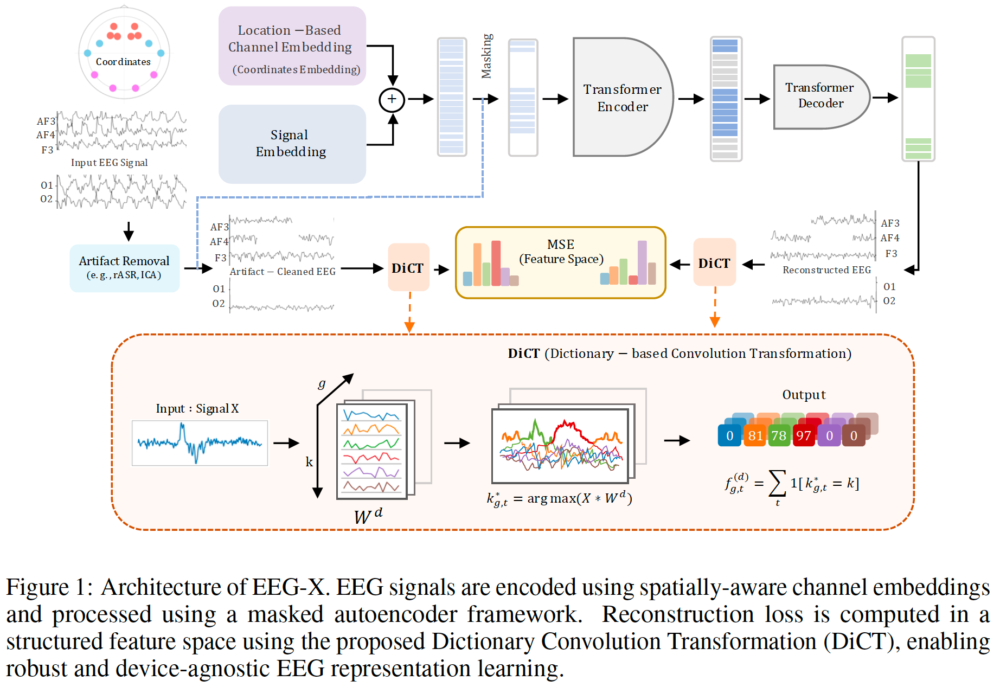

## EEG-X: Device-Agnostic and Noise-Robust Foundation Model for EEG

#### EEG-X Paper: [comming soon](https:)

This is a PyTorch implementation of **EEG-X: Device-Agnostic and Noise-Robust Foundation Model for EEG**

    

 

## Setup

_Instructions refer to Unix-based systems (e.g. Linux, MacOS)._

This code has been tested with `Python 3.9.12`.

`pip install -r requirements.txt`

## Run

To see all command options with explanations, run: `python main.py --help`
In `main.py` you can select the datasets and modify the model parameters.
For example:

`self.parser.add_argument('--epochs', type=int, default=100, help='Number of training epochs')`

or you can set the parameters:

`python main.py --epochs 100 --data_dir Dataset/Crowdsource`

### Test 2