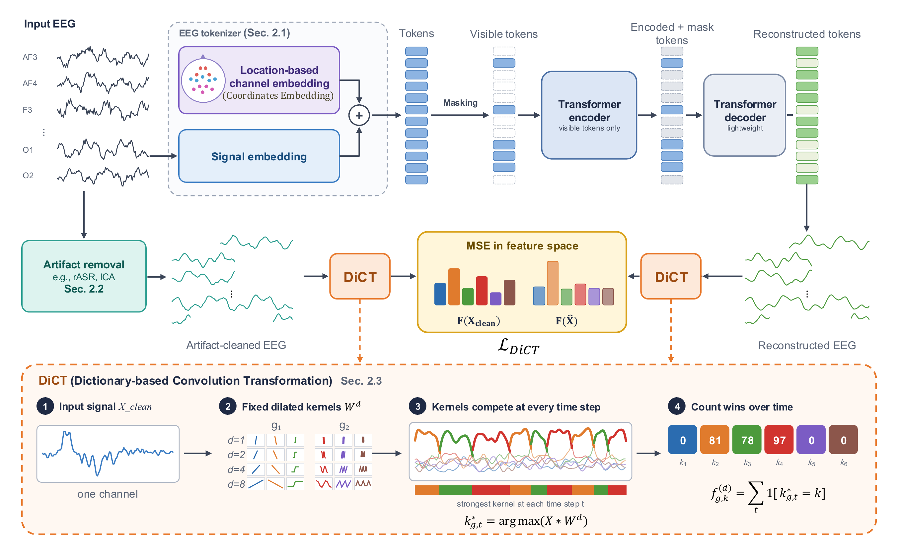
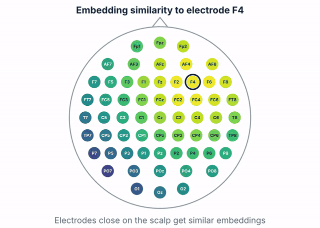
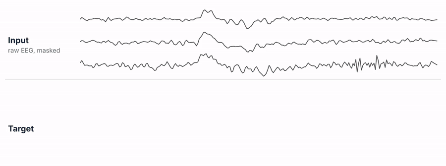
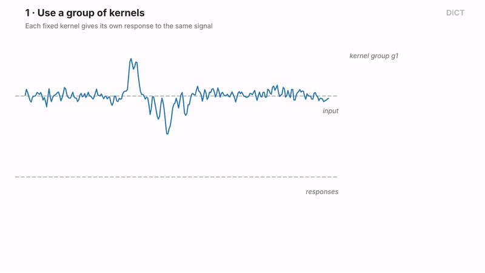

<h1 align="center">EEG-X: Toward Device-Agnostic and Noise-Robust Foundation Models for EEG</h1>

<p align="center">
  <a href="https://scholar.google.com.au/citations?user=Ax62P1MAAAAJ&hl=en"><b>Navid Fuman</b></a><sup>1</sup> &nbsp;·&nbsp;
  <a href="https://www.linkedin.com/in/soheila-ghane/"><b>Soheila Ghane</b></a><sup>2*</sup> &nbsp;·&nbsp;
  <b>Nam Nguyen</b><sup>1</sup> &nbsp;·&nbsp;
  <a href="https://research.monash.edu/en/persons/mahsa-salehi"><b>Mahsa Salehi</b></a><sup>3</sup> &nbsp;·&nbsp;
  <a href="https://giwebb.com/"><b>Geoffrey I. Webb</b></a><sup>3</sup> &nbsp;·&nbsp;
  <a href="https://www.linkedin.com/in/geoffmackellar/"><b>Geoffrey Mackellar</b></a><sup>1</sup>
</p>

<p align="center">
  <sup>1</sup>Emotiv Research &nbsp;&nbsp; <sup>2</sup>Google &nbsp;&nbsp; <sup>3</sup>Monash University<br>
  <sup>*</sup>Work done while at Emotiv Research
</p>

<p align="center">
  <a href="https://arxiv.org/abs/2511.08861"></a>
  <a href="https://neurips.cc/virtual/2026/loc/sydney/poster/152276"></a>
  <a href="https://recorder-v3.slideslive.com/#/share?share=115520&s=5ed87d84-4130-4083-adfc-18e38c0920f7"></a>
</p>

PyTorch implementation of **EEG-X**, accepted at **NeurIPS 2026**.
See [the model](docs/model.md) for architecture, loss and training settings.

**Links:** [Paper (arXiv)](https://arxiv.org/abs/2511.08861) · [NeurIPS 2026 poster page](https://neurips.cc/virtual/2026/loc/sydney/poster/152276) · [Short video](https://recorder-v3.slideslive.com/#/share?share=115520&s=5ed87d84-4130-4083-adfc-18e38c0920f7)

<p align="center">
  
</p>

## What does this paper present?

Foundation models for EEG are held back by two problems:

1. **Device variability.** Datasets differ in recording devices, number of channels and electrode layouts, so models trained on one headset rarely transfer to another.
2. **Low signal-to-noise ratio.** Neural activity is often buried under artifacts and non-brain sources, and reconstructing raw EEG teaches a model to reproduce that noise.

EEG-X is a masked-autoencoder foundation model for EEG that addresses both with three ideas.

### 1. Location-based channel embedding (device-agnostic)

Instead of learning one embedding per electrode name, EEG-X embeds each electrode from its **scalp coordinates**. Electrodes that are close on the scalp get similar embeddings, and any headset (Emotiv EPOC with 14 channels, BCI IV 2a with 22, an 8-channel SSVEP cap, and so on) maps onto the same coordinate space. A new device therefore needs no new embeddings.

<p align="center">
  
</p>

<p align="center"><a href="Figs/channels.mp4">Watch as MP4</a></p>

### 2. Noise-aware masking and reconstruction

Previous masked-reconstruction methods must rebuild the raw EEG, artifacts included. EEG-X keeps the raw, masked EEG as the **input** but reconstructs an **artifact-cleaned** version of the signal (artifact removal such as rASR), so the model is rewarded for neural activity only.

<p align="center">
  
</p>

<p align="center"><a href="Figs/masking.mp4">Watch as MP4</a></p>

### 3. DiCT: Dictionary-based Convolution Transformation

Comparing a reconstruction with its target point by point is sensitive to small shifts and amplitude changes. **DiCT** compares signals in a structured feature space instead:

1. A fixed, randomly generated group of dilated convolution kernels is applied to the signal, and each kernel produces its own response.
2. At every time step, the kernels in a group **compete** and the strongest response wins.
3. Counting how often each kernel wins gives a compact representation of the signal's shape and frequency content.

The loss is the MSE between the DiCT representations of the cleaned target and the reconstruction. DiCT has no learnable parameters.

<p align="center">
  
</p>

<p align="center"><a href="Figs/dict.mp4">Watch as MP4</a></p>

### Evaluation

EEG-X is evaluated on datasets recorded with different EEG devices, both **in-domain** (pre-training and downstream data come from the same dataset) and **cross-domain** (pre-training on TUAB, downstream on datasets with different electrode layouts and recording configurations). See the paper for the full results.

## Citation

```bibtex
@article{foumani2025eegx,
  title   = {EEG-X: Toward Device-Agnostic and Noise-Robust Foundation Models for EEG},
  author  = {Mohammadi Foumani, Navid and Ghane, Soheila and Nguyen, Nam and Salehi, Mahsa and Webb, Geoffrey I. and Mackellar, Geoffrey},
  journal = {arXiv preprint arXiv:2511.08861},
  year    = {2025}
}
```

## License and use

The code and pretrained models are released for **research and academic purposes only**. Commercial or business use requires prior authorization from the authors or the relevant rights holders. Datasets remain subject to their own terms and conditions.

## Setup

Use Python 3.12 or 3.13. Install the pinned environment:

```sh
uv sync --locked --dev
uv run --locked --no-active python Main.py --help
```

## Data

Place the latest prepared HDF5 bundle in `data/`, beside its tracked
`manifest.json`, `protocol.json`, `study.json` and `split-selection-evidence.json`.
The HDF5 files are distributed separately and excluded from Git.
Each file contains signals, labels, channel identities, preprocessing,
subject provenance and the saved train/validation/test indices.

| Dataset files                                                              |
| -------------------------------------------------------------------------- |
| `dreamer-arousal.h5`, `stew.h5`, `tuab.h5`, `tuev-binary.h5`       |
| `crowdsourced.h5`, `bciciv-2a.h5`, `kalunga.h5`, `physionet-mi.h5` |

Both evaluation domains use the same target file and saved subject split.
Verify the bundle against the tracked manifest before training:

```sh
uv run --locked --no-active python - <<'PYTHON'
import hashlib
import json
from pathlib import Path

root = Path("data")
for entry in json.loads((root / "manifest.json").read_text())["datasets"].values():
    path = root / entry["file"]
    with path.open("rb") as handle:
        digest = hashlib.file_digest(handle, "sha256").hexdigest()
    if digest != entry["sha256"]:
        raise SystemExit(f"Checksum mismatch: {path}")
    print(f"Verified: {path.name}")
PYTHON
```

To rebuild from the earlier prepared corpus, use the saved protocol:

```sh
uv run --locked --no-active python -m pretrain.pipeline.release \
  --source /path/to/original-prepared-data \
  --output .runs/rebuilt-data --protocol data/protocol.json
```

The output directory must be new. Copy its HDF5 files into `data/` to use the
configs below. The builder preserves signal values and audits all window hashes.
For native recording preparation, see `python -m pretrain.pipeline.prepare --help`.

## Reproduce training

In `configs/`, set the local device, output, budget and W&B account.
Paths resolve beside each YAML. Keep dataset identities, saved splits and training
settings unchanged. Use the existing budget ledger for an ongoing study.
Authenticate with `wandb login`, or set `wandb.enabled: false` for local logs.
Checkpoints stay local by default. W&B still records metrics, system logs and
confusion matrices. Set `wandb.upload_checkpoints: true` only when cloud model
artifacts are needed.

For a new study, initialize the budget at the path configured in YAML:

```sh
uv run --locked --no-active python - <<'PYTHON'
from pretrain.pipeline.budget import Budget
Budget(".runs/eegx-fixed-v1/usage/gpu1").initialize()
PYTHON
```

For an existing study, reuse its saved ledger. Run the complete study sequentially
in dependency order:

```sh
bash run_paper.sh
```

The launcher reads YAMLs directly and stops on the first failed stage.
It trains each target before its in-domain fine-tuning, then trains the shared
TUAB source before cross-domain evaluation. Logs remain in each run output.

For a single stage:

```sh
uv run --locked --no-active python Main.py --config configs/stew.yaml
```

In-domain fine-tuning uses each seed's selected pretraining checkpoint.
Cross-domain stages share the selected TUAB source checkpoint.

For a separate model-size comparison, prepare a frozen queue from these same
YAMLs. Review its source and generated configs before measuring capacity or
starting training. This preserves existing outputs and the saved data splits:

```sh
python tools/queue/prepare.py --root .runs/eegx/d8w512 --depth 8 --width 512
python .runs/eegx/d8w512/source/tools/queue/capacity.py --manifest .runs/eegx/d8w512/manifest.json
python .runs/eegx/d8w512/source/tools/queue/run.py --manifest .runs/eegx/d8w512/manifest.json
```

The queue uses both GPUs as measured peak memory allows. W&B records the model
`size` for grouping with the existing runs. Its model count is documented in
[docs/model.md](docs/model.md).

To run a subset, add `--datasets stew dreamer-arousal tuev-binary --domains in_domain`
to preparation. `--devices 0` pins that queue to one GPU. Use a different GPU for
an independent concurrent queue to avoid overlapping admission decisions.
Capacity profiling accepts `--gpu 0` to measure both sizes on the same physical
GPU when the installed GPUs match. Its inference timings use resident inputs
under the current shared GPU load, so they are provisional rather than isolated
speed comparisons.

| Study rule             | Value                                                                          |
| ---------------------- | ------------------------------------------------------------------------------ |
| Training seeds         | 241, 242, 243; same subject split for every seed                               |
| Paired study           | 73 runs, as defined in `data/study.json`                                     |
| TUAB and TUEV          | Official test; official training subjects split 80/20 for train/validation     |
| STEW / DREAMER arousal | Saved split 241 / 242; historical test-informed selection, exploratory results |
| Other targets          | Saved split 241, fixed without a target score search                           |

Pretraining selects minimum validation raw MSE. Downstream stages select maximum
validation balanced accuracy, then evaluate test once. Embedded test probes are diagnostic.

Each output saves resolved config, split identity, checkpoints, history and predictions.
To resume, set a scalar `seed`, set `resume` to its `training/last.pth`, and use a fresh
output with the same source, environment, data and training settings.

## Checks

```sh
uv run --locked --no-active python -m pytest -q
```

Prepared-data recipe and catalog names describe the signal operations and sample policy. Validation checks the recorded operations and catalog content, so historical display names do not require rewriting existing datasets. Source and checkpoint hashes remain strict; use a matching frozen source snapshot to resume an existing run.
