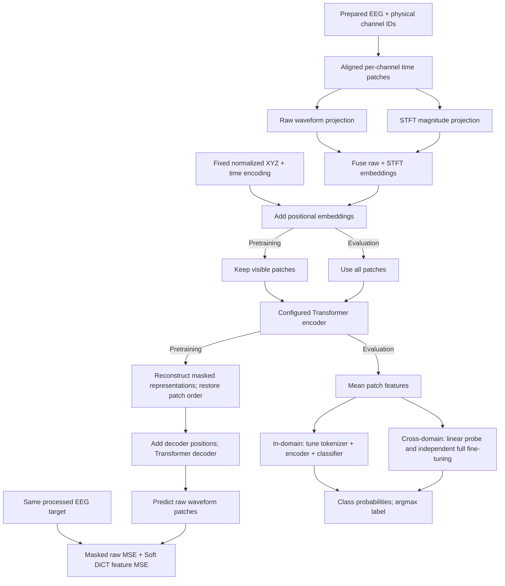

# EEG-X paper rerun specification

Status: the user selected the proposal as the local default. The pipeline retains the EEG-X context encoder and trainable Predictor, with no teacher or EMA. See the [readiness review](training-review.md) for checks and remaining source requirements.

Current execution uses one YAML configuration and one local command. Each invocation runs one selected model over the configured seed list, sequentially in fresh local processes on the selected GPU. Each seed saves its resolved settings, subject split, logs and checkpoints; input errors stop the loop. The repository has no SLURM integration, study plan, controller or seed-summary job. W&B records and groups independent seed runs.

The [task log](task.md) records the selected defaults and fallbacks for author discussion. The [supplied-paper review](paper-review.md) supersedes the earlier arXiv comparison. The user approved the documented local differences; this does not mean that every setting appears in the manuscript or has separate author approval.

## Goal and fixed requirements

Reproduce the evaluation pipeline and regenerate EEG-X paper results on consistent subject splits. Save enough evidence to rerun every result. Published scores and previous checkpoints cannot substitute for these new runs.

| Component | Required configuration |
|---|---|
| Primary model | Encoder depth 8, embedding width 64, attention heads 8 |
| Tokenizer | Combined raw patches and STFT magnitude |
| Patch length | 32 samples |
| Decoder | 4 Transformer layers, 8 attention heads |
| Channel embedding | Fixed EEG-X2 scaling XYZ sin/cos features, vocabulary-wide centering/radius normalization, base 5, gain 1/sqrt(3K), and zero padding |
| Mask ratio | 75% |
| Reconstruction objective | Masked raw waveform MSE plus Soft DiCT temporal-count feature MSE; default when objective is omitted |
| Pretraining | At most 100 epochs, with validation-based early stopping |
| In-domain evaluation | Fine-tune tokenizer, encoder, and classifier for 20 epochs |
| Cross-domain evaluation | Both frozen-encoder linear probing and full fine-tuning, independently from one shared TUAB checkpoint |
| Independent runs | 5 seeds: 241, 242, 243, 244, 245 |
| Attention backend | FlashAttention where supported; record the actual backend and any fallback |
| Optimizer and scheduler | StableAdamW pretraining; AdamW fine-tuning; warmup/cosine for both; save actual resolved settings |

Use the current EEG-X model as the implementation base. Keep its active reconstruction path unless the agreed configuration requires a change. Train only the selected configuration. Old baseline rows remain historical until rerun on the new splits.

## Data and subject splits

Prepare each raw dataset with the shared EEG-X2 recipe and publish one self-contained HDF5 file. Store prepared windows, labels, source records, native subjects, physical channels/XYZ, stable window identities and all saved split indices. Explicit imports of historical processed releases preserve their values and record their upstream history separately.

The latest sample reference is the original saved NPY catalog. Restore its strides,
overlap and multiplicity while changing signal processing to EEG-X2. Keep identical
recordings and duplicate-linked subjects in the same partition. Crowdsourced uses
correct native timing and windows within acquisition/label boundaries; report its
count difference. Other unverified crop mappings block only the affected dataset.
See docs/task.md for reference counts and reconstruction status.

The user waived proof of upstream non-rASR history. Reconstruct the same processed X arrays supplied as input and add no local rASR. Preserve existing history when available; unknown upstream history does not block training and must not be reported as verified. This differs from the manuscript's rASR-cleaned target method.

| Task | Role | Window | Label contract |
|---|---|---:|---|
| DREAMER arousal | Separate pretraining and in-domain fine-tuning | 2 s | High if rating >3, otherwise low; this is the verified local experiment rule, not a documented paper threshold |
| STEW workload | Separate pretraining and in-domain fine-tuning | 2 s | Native low/high TXT recordings; preserve participant identity across both conditions |
| TUAB | Separate pretraining, in-domain fine-tuning, and transfer source | 10 s | Official normal/abnormal labels |
| TUEV binary | Separate pretraining and in-domain fine-tuning | 2 s | Native classes 1/2/3 positive, 6 negative; exclude 4/5; native REC annotations are authoritative, with archive audits optional |
| Crowdsourced | Cross-domain linear probing and fine-tuning from TUAB | 2 s | Eyes closed/open; retain author-backed recording ownership |
| BCICIV-2a | Cross-domain linear probing and fine-tuning from TUAB | 2 s | Verified trial +2 to +4 seconds; feet 0, left hand 1, right hand 2, tongue 3 |
| Kalunga SSVEP | Cross-domain linear probing and fine-tuning from TUAB | 2 s | Rest and 13/21/17 Hz; use the corrected author-backed event map |
| PhysioNetMI | Cross-domain linear probing and fine-tuning from TUAB | 2 s | Native imagery EDFs, five classes including task-rest; verified catalog omits initial events and retains later short annotations. Use true 2-second crops at actual rates; complete subject scope by default |

Each in-domain model starts from scratch. Each cross-domain run starts independently from one shared TUAB encoder with the matching architecture. Source and target seeds need not match. Source pretraining uses the proposed subject-wise 80/20 train/validation split and selects minimum validation reconstruction loss.

New pretraining checkpoints record the source task, release hash and subject-split identity. In-domain fine-tuning requires the same prepared dataset and split as pretraining. Cross-domain linear probing and fine-tuning require the shared TUAB train/validation source. A mismatched or missing source identity stops evaluation before test access and result logging.

| Split decision | Contract |
|---|---|
| Subject pool | Combine subjects from the old train, validation, and test partitions before assigning new roles |
| Split bank | A separate subject-wise train/validation/test split for each of the 5 seeds |
| Selected ratio | Approximately 70/10/20 by subject; keep duplicate-linked subject groups intact and persist actual counts |
| Rounding | Python round defines target subject counts; use nearest cumulative group boundary while reserving an independent group per role |
| Pairing | Reuse each seed's split across every architecture and objective comparison |
| Old official partitions | Pool TUAB/TUEV subjects too; preserving the old official test split is superseded by Navid's new split request |
| Integrity | Subjects and unresolved duplicate groups must not cross partitions; every evaluated class must be present |
| Preprocessing | Native preparation uses EEG-X2 QuantPlus: native reference, no additional notch, high-pass 0.5 Hz, low-pass 45 Hz, resample 128 Hz, per-recording/channel StandardScaler, clip ±15 and float32. Selected processed releases preserve their saved values |
| Artifact-removal policy | Add no local rASR; upstream non-rASR proof is optional |
| Processed inputs | Use stored signals, labels and participant IDs from the selected artifact; reject incompatible shape, missing subjects, invalid labels or changed artifact hashes |
| Duplicate policy | Retain reference multiplicity and group subjects linked by full-record or emitted-window signal hashes; reject any saved bank splitting a linked group |

HDF5 datasets and their persisted split banks must be immutable and versioned. Missing participant or label evidence blocks the affected task.

Publish the HDF5 file atomically after label, subject-group, reference-count and class-coverage checks. Original overlap and repeated annotations remain valid samples. Upstream non-rASR history is optional. No persistent task state is created.

YAML defaults to paper intent and requires a complete verified reference catalog.
Explicit engineering intent supports pilot checks and stays recorded in the run.
Paper downstream evaluation requires a paper-pretrained source checkpoint; an
engineering checkpoint cannot become a paper source.

## HDF5 storage and loading

The preparation entrypoint writes one dataset file with prepared window tensors,
labels, record/subject provenance, physical channel names/IDs/XYZ, exclusions and
stable window identities. All seed split arrays are stored in that same file.
The shared TUAB source has its own train/validation bank without copying signals.
Training selects a stored bank and writes only a run-level provenance report.
Established original-array row mappings, ambiguity sets and reference artifact
hashes are embedded in the HDF5 metadata. The reader validates their complete
native-crop coverage and source hashes. Mapped native generation requires the
verified lineage input; training needs no proof sidecar.

Window and recording identities exclude host paths and split seeds. Canonical
record/window ordering makes regenerated row indices independent of source
iteration order. The reader validates metadata and index hashes, reads windows
lazily, and opens HDF5 handles per worker process. It performs no signal transforms.

## Target model flow

The diagram shows the implemented reconstruction and classification paths.

Both tokenizer branches describe the same channel and time patch. The revised path retains the active cross-attention Predictor before patch restoration. It omits only the unused teacher target computation, which did not contribute to the existing reconstruction loss. No teacher or latent loss is added.

| Selected design choice | Value and reason |
|---|---|
| STFT settings | FFT length 32, Hann window length 32, hop 32, center=False, normalized=True, one-sided magnitude; 17 frequency bins |
| Fusion | Project raw and magnitude patches to the same width, then add them; retain the original token count |
| Mask integrity | Each STFT window stays inside its raw patch, so visible tokens cannot read hidden samples |
| Decoder width | Match the encoder width; the author table fixes decoder depth and heads, not its width |
| Normalization | Use all-RMSNorm in encoder, decoder, attention Q/K, and classifier head |
| Spatial features | Port the exact EEG-X2 fixed XYZ coordinate and feature contract; normalize against the whole frozen vocabulary, never the current headset |
| Feature pooling | Mean patch tokens |
| Teacher and latent losses | Retain the existing one-layer cross-attention Predictor in the active reconstruction path. Omit the unused teacher target computation. Add the required four-layer Transformer decoder before the per-patch raw waveform projection; add no latent objective |

These are selected implementation choices, not additional parameters supplied by Navid. Train new models from scratch; support for historical checkpoints is outside scope. Versioned checkpoints record the selected model and objective for integrity and reproducible resume. Use fresh output directories and carry the existing budget ledger forward.

### Soft DiCT objective

The default pretraining objective combines masked raw waveform MSE with Soft DiCT feature MSE. Channels share seeded random filters but compete independently. Kernel assignments use softmax responses divided by a fixed temperature; features sum assignment probabilities over time, then concatenate across channels, kernel sizes, groups, and dilations. Preserve the manuscript's dictionary layout without additional difference branches, amplitude weighting, square-root features, or temporal means.

Filters are sampled with a local seeded CPU generator, centered per kernel, normalized to unit L2 norm, and stored as fixed buffers. Soft routing is differentiable in forward and backward. It replaces the manuscript's hard winner counts; it is not numerically identical to them. Gradient checks do not establish better downstream accuracy.

Compare the reconstructed waveform with a detached target. Keep the feature transform fixed and seeded. Pin its feature definition, temperature, numerical stabilization, and loss weight before training. Check ordinary signals, zero reconstructions, never-winning features, finite gradients, and checkpoint round trips.

## Training, selection, and monitoring

| Setting | Planned policy |
|---|---|
| Pretraining optimizer starting point | StableAdamW, peak learning rate 2.4e-4, betas (0.9, 0.95), epsilon 1e-9, weight decay 0.01 |
| Scheduler starting point | Warmup for 10 epochs, then cosine decay to 1e-5 over the maximum 100-epoch horizon; freeze the exact schedule before training |
| Early stopping default | Validation masked raw MSE; patience 10 epochs after warmup; minimum improvement 1e-4; retain the best checkpoint |
| Validation masks | Fixed within a seed and shared across configurations; training masks vary deterministically |
| Logical pretraining batch | Minimum of 256 and available training windows; benchmark and record the microbatch for each input size; keep incomplete batches |
| Precision | BF16 autocast, FP32 loss reductions and Hydra, TF32 matmul; record effective settings |
| Soft DiCT defaults | Weight 1, temperature 1, 32 kernels per group, 8 groups, lengths 9/15, dilations 1/2/4/8/16; FP32 soft counts and MSE; fixed seeded channelwise filters |
| Fine-tuning | Train tokenizer, encoder and classifier for at most 20 epochs; select highest validation balanced accuracy; stop after 5 checks without improvement |
| Supervised optimizer/scheduler | AdamW, learning rate 1e-3, betas (0.9, 0.999), weight decay 0.01 for matrices and zero otherwise; layer learning-rate decay 0.75, warmup 5 epochs then cosine to 1e-6, gradient clipping 1; RMSNorm, dropout 0.1, linear classifier; cross entropy without label smoothing |
| Linear-probe classifier default | Frozen encoder; train-only StandardScaler; linear head, AdamW LR 1e-3 and weight decay 0.01; at most 20 epochs; select highest validation balanced accuracy; stop after 5 checks without improvement |
| Training-time probes | Every 10 epochs and at the selected checkpoint; fit scaler and classifier on training subjects only; validation/test curves belong to the same pretraining W&B run |
| Standalone linear probes | Cross-domain experiments only in the agreed paper workflow; reuse one shared TUAB checkpoint with the matching architecture |
| Fine-tuning reporting | Validation curves each epoch; select best validation balanced accuracy, lock the checkpoint, then evaluate test once |
| Test probe request | Log test curves for intuition only; never use them for checkpoint selection, early stopping, thresholds, or hyperparameter changes |

Pin these choices before inspecting test curves. If test feedback guides a change, treat that split as development data and obtain a fresh untouched holdout for the paper.

## Metrics and W&B results

| Output | Contract |
|---|---|
| Binary classification | Headline balanced accuracy and AUROC; also log accuracy, class-1 F1, F1 micro/macro/weighted, macro precision and recall, AUPRC and loss; AUROC/AUPRC use class 1 probability |
| Multiclass classification | Headline balanced accuracy and F1 weighted by test class frequency; also log accuracy, F1 micro/macro, macro precision and recall, macro one-vs-rest AUROC/AUPRC and loss |
| Reporting unit | Pool windows across held-out subjects; do not average subject scores |
| Scale | Accuracy, F1, precision, recall and AUC scores are 0-1, higher is better; classification loss and reconstruction MSE are nonnegative, lower is better |
| Repeated runs | Publish each seed; mean and sample standard deviation only after all 5 seeds complete |
| Final evaluation | Linear probes and fine-tuning maximize validation balanced accuracy; retain the first checkpoint on ties; early stopping follows the same metric. Pretraining minimizes validation reconstruction loss. Test evaluates the locked checkpoint once; final scalar test metrics are summary-only bars, without an epoch axis |
| W&B | Log model name, task name, stage, evaluation mode, recipe and seed; online resume reuses the saved run ID |
| Grouping | No preset grouping. User chooses domain, stage and task in W&B; filter to one model and recipe and include distinct completed seeds |

Balanced accuracy is mean recall across classes. Report the architecture, split, seed, and evaluation mode beside every result.

| Paper scope, subject to source availability | In-domain pretraining | In-domain fine-tuning | Shared TUAB source | Cross-domain linear probes | Cross-domain fine-tuning | Total |
|---|---:|---:|---:|---:|---:|---:|
| Primary architecture: depth 8, width 64 | 20 | 20 | 1 | 20 | 20 | 81 |

These counts describe paper scope, not a scheduled job matrix or completed results. Missing data and budget limits remain explicit.

## Work required before paper runs

- [ ] Record the selected processed release, stored participant IDs and labels, and reconcile duplicate counts; upstream non-rASR proof is waived.
- [ ] Generate and save the independent split bank; test subject separation and class coverage.
- [x] Resolve teacher/latent scope; implement the hybrid tokenizer, primary model, and actual attention-backend reporting.
- [x] Add early stopping, the revised fine-tuning horizon, classifier-only cross-domain evaluation, and diagnostic probe logging.
- [ ] Pin complete optimizer/scheduler and tokenizer configurations; save tokenizer, encoder, classifier, scaler, and random states.
- [ ] Test masking without STFT leakage, gradients, input/channel variants, checkpoint round trips, exact resume, and selection without test feedback.
- [ ] Review code against this contract, fix findings, then pass real-data CPU and GPU checks before full training.
- [ ] Complete the primary model across eligible datasets and seeds and record their final W&B test metrics.

Implementation and checks must live in this repository. Keep failed and incomplete runs visible.

| Execution and reproducibility | Contract |
|---|---|
| Shared GPU budget | 72 GPU-hours across all local experiments and revised runs; carry the existing ledger without resetting it |
| Setup accounting | Charge 300 seconds once when creating a new budget ledger; preserve existing ledgers without a second setup debit |
| Device | User-selected paper expansion uses physical GPUs 0 and 1 in explicit shared mode; never stop unrelated workloads |
| Concurrent tasks | Four pipelines per device. GPU 1 owns seeds 241/242/243; GPU 0 owns 244/245 and the single shared TUAB source. Preserve checkpoint progress, verify completed tasks and lock each output against duplicate dispatch |
| Aggregate accounting | Keep the original ledger and prior usage. GPU 0 has an auxiliary usage meter, not a second allowance. Charge occupied time once per device, add only new meter debits, and stop study owners safely at the unchanged aggregate cap. Auxiliary configurations require the shared launcher |
| Queue ownership | Never reparent live training processes. Transfer ownership through checkpoint resume into fresh attempts with the original W&B IDs and unchanged frozen source. Separate queue sessions prevent terminal hangup from bypassing cleanup. Gate GPU 0 on verified resumed GPU 1 IDs, and gate targets on successful source finalization |
| Storage | Work volume for code, environment, caches, data, and outputs; retain the home compatibility symlink |
| Isolation | Fresh output per direct YAML run; preserve safe progress on stop |
| Frozen evidence | Source revision, uv lockfile, resolved configuration, preprocessing, channel vocabulary, participant splits, data hashes, checkpoints, predictions, metrics, and exclusions |
| Resume | Reject changed model, tokenizer, data, split, objective, optimizer, scheduler, random-state, or compute contracts |
| Code-speed comparison | Fix logical and physical batch sizes; use one physical batch per update without gradient accumulation; hold data order, precision, hardware, warmup, and measured update count fixed. Treat larger microbatches as separate capacity tuning |
| Publication | Replace EEG-X table entries only with measured revised-run results; mark old-split baselines as historical until rerun |

The implementation remains local. Completed experiments supply verified per-seed predictions and W&B metrics. Aggregation happens in W&B. Unknown source history and unavailable GPU capacity remain explicit; pilot and synthetic checks cannot supply paper scores.
