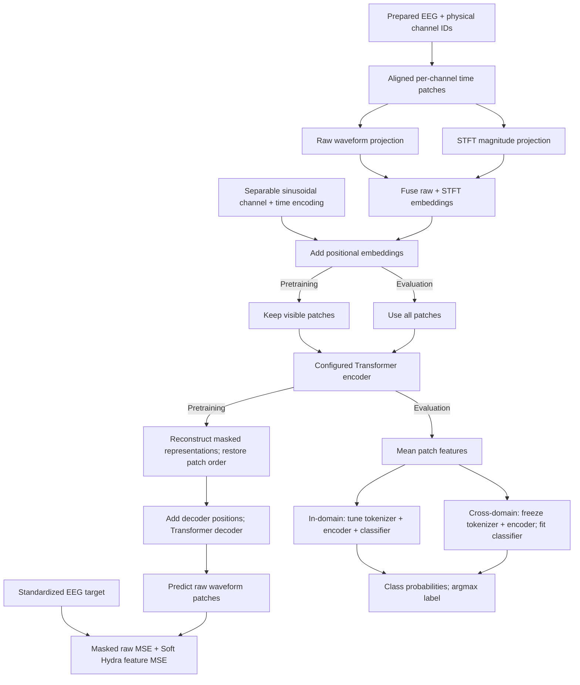

# EEG-X paper rerun specification

Status: documentation only. Adapt the current EEG-X main implementation with the smallest changes needed for this contract. See the [readiness review](training-review.md) for the work remaining.

## Goal and fixed requirements

Reproduce the evaluation pipeline and regenerate EEG-X paper results on consistent subject splits. Save enough evidence to rerun every result. Published scores and previous checkpoints cannot substitute for these new runs.

| Component | Required configuration |
|---|---|
| Primary model | Encoder depth 8, embedding width 64, attention heads 8 |
| Scaling grid | Encoder depths 8/16; embedding widths 64/128/512; attention heads 8 |
| Tokenizer | Combined raw patches and STFT magnitude |
| Patch length | 32 samples |
| Decoder | 4 Transformer layers, 8 attention heads |
| Channel embedding | Separable sinusoidal encoding |
| Mask ratio | 75% |
| Reconstruction objective | Raw masked waveform MSE + Soft Hydra feature MSE |
| Pretraining | At most 100 epochs, with validation-based early stopping |
| In-domain evaluation | Fine-tune tokenizer, encoder, and classifier for 20 epochs |
| Cross-domain evaluation | Freeze tokenizer and encoder; train only the classifier |
| Independent runs | 5 seeds: 241, 242, 243, 244, 245 |
| Attention backend | FlashAttention where supported; record the actual backend and any fallback |
| Optimizer and scheduler | StableAdamW with warmup and cosine decay; pin all resolved settings before training |

Use the current EEG-X model as the implementation base. Keep its active reconstruction path unless the agreed configuration requires a change. Complete the primary model before scaling. Other public models are optional after the EEG-X results; old baseline rows remain historical until rerun on the new splits.

## Data and subject splits

Start from the processed EEG-X release on Axon. Audit participant IDs, labels, channels, units, preprocessing, and duplicate samples before reuse. Never filter or normalize an already processed input again without proven need.

Use non-rASR sources. Do not apply rASR during preparation. Verify and record that upstream rASR was not applied before reusing processed signals; the local `rasr=False` setting alone does not establish their history. Unknown or incompatible source history blocks reuse until verified or rebuilt from a documented non-rASR source.

| Task | Role | Window | Label contract |
|---|---|---:|---|
| DREAMER arousal | Separate pretraining and in-domain fine-tuning | 2 s | High if rating >3, otherwise low; this is the verified local experiment rule, not a documented paper threshold |
| STEW workload | Separate pretraining and in-domain fine-tuning | 2 s | High if rating >4, otherwise low; verify original ratings and participant IDs before use |
| TUAB | Separate pretraining, in-domain fine-tuning, and transfer source | 10 s | Official normal/abnormal labels |
| TUEV binary | Separate pretraining and in-domain fine-tuning | 2 s | Native classes 1/2/3 positive, 6 negative; exclude 4/5; verify correspondence to the processed release |
| Crowdsourced | Frozen cross-domain evaluation from TUAB | 2 s | Eyes closed/open; retain author-backed recording ownership |
| BCICIV-2a | Frozen cross-domain evaluation from TUAB | 4 s | Left hand, right hand, feet, tongue |
| Kalunga SSVEP | Frozen cross-domain evaluation from TUAB | 2 s | Rest and 13/21/17 Hz; use the corrected author-backed event map |

Each in-domain model starts from scratch. Each cross-domain classifier uses the TUAB encoder trained with the matching seed and architecture.

| Split decision | Contract |
|---|---|
| Subject pool | Combine subjects from the old train, validation, and test partitions before assigning new roles |
| Split bank | A separate subject-wise train/validation/test split for each of the 5 seeds |
| Proposed ratio | 70/10/20 by subject; persist the actual rounded assignments |
| Rounding | Python round; at least 1 validation and 1 test subject, while retaining training subjects |
| Pairing | Reuse each seed's split across every architecture and objective comparison |
| Old official partitions | Pool TUAB/TUEV subjects too; preserving the old official test split is superseded by Navid's new split request |
| Integrity | Subjects and unresolved duplicate groups must not cross partitions; every evaluated class must be present |
| Preprocessing | Target 128 Hz, average reference, 60 Hz notch where supported, 0.5-45 Hz FIR bandpass, recording/channel z-score, clip to ±15, float32; verify source units and physical channel order |
| Artifact-removal policy | Non-rASR inputs only; no local rASR; preserve evidence of upstream processing in each prepared manifest |
| Incompatible processed inputs | Rebuild from native data only with traceable participant mapping and a documented preprocessing decision |
| Duplicate policy | Reconcile duplicates and retained counts with the processed release before freezing exclusions; document exclusions before freezing the new datasets |

New split manifests must be immutable and versioned. Missing participant or label evidence blocks the affected task.

## Target model flow

The diagram shows the proposed reconstruction and classification paths. It does not claim that the revised model is already implemented.

Both tokenizer branches describe the same channel and time patch. The paper's teacher/latent path remains a design question below; the diagram is not approval to remove it.

| Proposed design choice | Value and reason |
|---|---|
| STFT settings | FFT length 32, Hann window length 32, hop 32, center=False, normalized=True, one-sided magnitude; 17 frequency bins |
| Fusion | Project raw and magnitude patches to the same width, then add them; retain the original token count |
| Mask integrity | Each STFT window stays inside its raw patch, so visible tokens cannot read hidden samples |
| Decoder width | Match the encoder width; the author table fixes decoder depth and heads, not its width |
| Normalization | Use all-RMSNorm in encoder, decoder, attention Q/K, and classifier head |
| Feature pooling | Mean patch tokens |
| Teacher and latent losses | Current main computes teacher targets that do not enter its loss, while Predictor outputs affect reconstruction. Resolve the teacher and decoder scope before changing that active path |

These are documented implementation choices, not additional parameters supplied by Navid. Resolve the teacher/latent scope before freezing the architecture.

### Soft Hydra objective

The agreed pretraining objective combines masked raw waveform MSE with Soft Hydra feature MSE. The current main implementation instead uses straight-through DiCT feature MSE alone, so the loss needs an explicit adaptation.

Soft Hydra uses differentiable feature competition in forward and backward. Straight-through DiCT uses hard winners in forward and soft gradients in backward. Their feature values and losses differ; gradient checks do not establish better downstream accuracy.

Compare the reconstructed waveform with a detached target. Keep the feature transform fixed and seeded. Pin its feature definition, temperature, numerical stabilization, and loss weight before training. Check ordinary signals, zero reconstructions, never-winning features, finite gradients, and checkpoint round trips.

## Training, selection, and monitoring

| Setting | Planned policy |
|---|---|
| Pretraining optimizer starting point | StableAdamW, peak learning rate 2.4e-4, betas (0.9, 0.95), epsilon 1e-9, weight decay 0.01 |
| Scheduler starting point | Warmup for 10 epochs, then cosine decay to 1e-5 over the maximum 100-epoch horizon; freeze the exact schedule before training |
| Early stopping default | Validation masked raw MSE; patience 10 epochs after warmup; minimum improvement 1e-4; retain the best checkpoint |
| Validation masks | Fixed within a seed and shared across configurations; training masks vary deterministically |
| Logical pretraining batch | Minimum of 256 and available training windows; benchmark and record the microbatch for each input size; keep incomplete batches |
| Precision | BF16 autocast, FP32 loss reductions and Hydra, TF32 matmul; record effective settings |
| Soft Hydra defaults | Weight 1, temperature 1, 8 kernels per group, 32 groups; fixed seeded channelwise filters |
| Fine-tuning | Train the tokenizer, encoder, and classifier together; select highest validation balanced accuracy |
| Supervised optimizer/scheduler | Pin the optimizer, learning rate, decay, warmup, clipping, and classifier head settings before launch |
| Frozen classifier default | Train-only StandardScaler and logistic regression, C=1, L2, LBFGS, maximum iterations 1,000,000 |
| Training-time probes | Every 10 epochs and at the selected checkpoint; fit scaler and classifier on training subjects only |
| Test probe request | Log test curves for intuition only; never use them for checkpoint selection, early stopping, thresholds, or hyperparameter changes |

Pin these choices before inspecting test curves. If test feedback guides a change, treat that split as development data and obtain a fresh untouched holdout for the paper.

## Metrics and regenerated tables

| Output | Contract |
|---|---|
| Binary classification | Balanced accuracy and AUROC; AUROC uses class 1 probability |
| Multiclass classification | Balanced accuracy and F1 weighted by test class frequency |
| Reporting unit | Pool windows across held-out subjects; do not average subject scores |
| Scale | Classification metrics 0-1, higher is better; reconstruction MSE lower is better |
| Repeated runs | Publish each seed; mean and sample standard deviation only after all 5 seeds complete |
| Final evaluation | Use validation-selected checkpoints and a fixed classifier recipe; keep diagnostic curves separate from final table entries |

Balanced accuracy is mean recall across classes. Report the architecture, split, seed, and evaluation mode beside every result.

| Planned scope, including blocked tasks | Pretraining | In-domain fine-tuning | Cross-domain frozen classifiers |
|---|---:|---:|---:|
| Primary architecture: depth 8, width 64 | 20 | 20 | 15 |
| Remaining 5 scaling architectures | 100 | 100 | 75 |
| Full 6-architecture grid | 120 | 120 | 90 |

These are planned runs, not completed results. Missing data or budget limits must remain explicit in the tables.

## Work required before paper runs

- [ ] Audit the processed release, recover true participant IDs, verify labels, preprocessing, and non-rASR source history, and reconcile duplicate counts.
- [ ] Generate and save the independent split bank; test subject separation and class coverage.
- [ ] Resolve teacher/latent scope; implement the hybrid tokenizer, primary model, scaling configurations, and actual attention-backend reporting.
- [ ] Add early stopping, the revised fine-tuning horizon, classifier-only cross-domain evaluation, and diagnostic probe logging.
- [ ] Pin complete optimizer/scheduler and tokenizer configurations; save tokenizer, encoder, classifier, scaler, and random states.
- [ ] Test masking without STFT leakage, gradients, input/channel variants, checkpoint round trips, exact resume, and selection without test feedback.
- [ ] Review code against this contract, fix findings, then pass real-data CPU and GPU checks before full training.
- [ ] Complete the primary model across eligible datasets and seeds, regenerate tables, then use remaining budget for scaling and optional baselines.

Implementation and checks must live in this repository. Keep failed and incomplete runs visible.

| Execution and reproducibility | Contract |
|---|---|
| Shared GPU budget | 72 GPU-hours across all local experiments and revised runs; carry the existing ledger without resetting it |
| Setup accounting | Charge 300 seconds once when creating a new study ledger; preserve existing ledgers without a second setup debit |
| Device | Physical GPU 1; never stop unrelated workloads |
| Storage | Work volume for code, environment, caches, data, and outputs; retain the home compatibility symlink |
| Isolation | Fresh output and screen session per experiment; preserve safe progress on stop |
| Frozen evidence | Source revision, uv lockfile, resolved configuration, preprocessing, channel vocabulary, participant splits, data hashes, checkpoints, predictions, metrics, and exclusions |
| Resume | Reject changed model, tokenizer, data, split, objective, optimizer, scheduler, random-state, or compute contracts |
| Code-speed comparison | Fix logical and physical batch sizes; use one physical batch per update without gradient accumulation; hold data order, precision, hardware, warmup, and measured update count fixed. Treat larger microbatches as separate capacity tuning |
| Publication | Replace EEG-X table entries only with measured revised-run results; mark old-split baselines as historical until rerun |

This PR contains documentation only. Implementation, code review, data verification, and the revised experiments remain future work.
